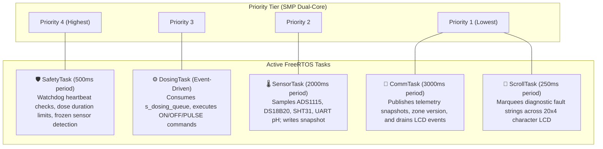

# 🌿 HydroponicsIDF — Autonomous Commercial Hydroponics Firmware

[](https://www.espressif.com/en/products/socs/esp32-s3)
[](https://docs.espressif.com/projects/esp-idf/en/release-v5.5/)
[](https://www.freertos.org/)
[](LICENSE)

**HydroponicsIDF** is a production-grade, safety-critical, FreeRTOS-based control firmware engineered for autonomous commercial hydroponics zones (NFT, Dutch Bucket, and DWC systems). Running on the dual-core **Espressif ESP32-S3** microcontroller (16MB Flash), the firmware continuously regulates water chemistry (pH and EC/TDS), schedules high-voltage environmental appliances, manages reservoir replenishment, guarantees life-support circulation, and streams telemetry via MQTT while offering headless HTTP Over-The-Air (OTA) updates.

---

## 📋 Table of Contents

- [System Overview & Key Features](#-system-overview--key-features)
- [Hardware & Pinout Architecture](#-hardware--pinout-architecture)
- [FreeRTOS Threading Model](#-freertos-threading-model)
- [Safety Subsystem & Watchdogs](#-safety-subsystem--watchdogs)
- [Quick Start: Build, Flash & Monitor](#-quick-start-build-flash--monitor)
- [First-Time Provisioning & Web Portal](#-first-time-provisioning--web-portal)
- [MQTT Topic & Command Interface](#-mqtt-topic--command-interface)
- [Repository File Map](#-repository-file-map)
- [Documentation Vault & References](#-documentation-vault--references)

---

## 🌟 System Overview & Key Features

```
                                  ┌────────────────────────┐
                                  │      MQTT Broker       │
                                  │   (Home Assistant /    │
                                  │   Custom Cloud Backend)│
                                  └───────────▲────────────┘
                                              │ Wi-Fi (MQTT + HTTP OTA)
                                              ▼
┌────────────────────────────────────────────────────────────────────────────────────────┐
│                              ESP32-S3 Firmware Topology                                │
│                                                                                        │
│  ┌──────────────────────┐   ┌───────────────────────┐   ┌───────────────────────────┐  │
│  │     Sensors & ADC    │   │  FreeRTOS Super-Core  │   │     Actuators & Relays    │  │
│  ├──────────────────────┤   ├───────────────────────┤   ├───────────────────────────┤  │
│  │ • ADS1115 (16-bit)   │──►│ • SafetyTask (Prio 4) │──►│ • Nut A/B Peristaltic     │  │
│  │ • DS18B20 (1-Wire)   │   │ • DosingTask (Prio 3) │   │ • pH Up/Down Peristaltic  │  │
│  │ • SHT31 (Temp/RH/VPD)│   │ • SensorTask (Prio 2) │   │ • Fresh Water Solenoid    │  │
│  │ • pH Sensor (UART1)  │   │ • CommTask   (Prio 1) │   │ • Circulation Pump (Lock) │  │
│  │ • Water Float Switch │   │ • ScrollTask (Prio 1) │   │ • 4x 10A AC Relays        │  │
│  └──────────────────────┘   └───────────────────────┘   └───────────────────────────┘  │
│                                         │                                              │
│                                         ▼                                              │
│                        ┌─────────────────────────────────┐                             │
│                        │       Local HMI Diagnostics     │                             │
│                        │ • 20x4 I2C Character LCD        │                             │
│                        │ • Marquee Fault String Display  │                             │
│                        │ • Connection & Alarm LEDs       │                             │
│                        └─────────────────────────────────┘                             │
└────────────────────────────────────────────────────────────────────────────────────────┘
```

- **Deterministic Concurrency**: Preemptive multi-threaded architecture with 4 prioritized FreeRTOS tasks to eliminate jitter and prevent network latency from blocking physical control.
- **Mutual Exclusion & Chemical Safety**: Hardware-level and software-enforced interlocks prevent mixing concentrated acid (pH Up) and base (pH Down) simultaneously.
- **Dual-Tier Watchdog Engine**: Hardware ESP-IDF Task Watchdog Timer (TWDT) paired with a software task heartbeat counter prevents undetected task starvation or deadlocks.
- **Dynamic 2-Point Linear Calibration**: Real-time pH and TDS calibration coefficients computed, validated, and persisted to Non-Volatile Storage (NVS) on-the-fly via MQTT.
- **Temperature Compensation**: Automatic Nernst/solution temperature normalization to 25°C for TDS and pH measurements using high-accuracy DS18B20 telemetry.
- **Fail-Safe Boot Clamping**: All relay and pump GPIOs are clamped `LOW` in early boot stages before the scheduler starts to eliminate relay chatter during brownouts or reboots. The circulation pump is locked `HIGH` to protect crop root health.
- **Zero-Touch Reconnect & Captive Portal**: Seamless headless recovery with exponential backoff on Wi-Fi/MQTT dropouts, backed by an on-demand SoftAP (`192.168.4.1`) captive web portal.

---

## 📌 Hardware & Pinout Architecture

The firmware is tailored for the **ESP32-S3** with external I2C, 1-Wire, and UART interfaces:

### Actuator & Relay Pinout
| Pin | Function | Active Level | Electrical Type | Description |
|:---:|---|:---:|:---:|---|
| **GPIO 41** | Nutrient A Pump | HIGH | 12V MOSFET / Relay | Peristaltic pump for fertilizer component A |
| **GPIO 40** | Nutrient B Pump | HIGH | 12V MOSFET / Relay | Peristaltic pump for fertilizer component B |
| **GPIO 39** | pH Up Pump | HIGH | 12V MOSFET / Relay | Peristaltic pump for alkaline buffer solution |
| **GPIO 38** | pH Down Pump | HIGH | 12V MOSFET / Relay | Peristaltic pump for phosphoric/nitric acid |
| **GPIO 12** | Freshwater Solenoid | HIGH | 12V MOSFET / Solenoid | Automatic reservoir water top-off valve |
| **GPIO 13** | **Circulation Pump** | **HIGH** | AC Relay / Optocoupler | **Life-support line:** Initialized `HIGH` at boot, protected from shutoff |
| **GPIO 47** | Relay 1 (Growlight) | HIGH | 10A / 250VAC Relay | Lighting schedule / photoperiod control |
| **GPIO 14** | Relay 2 (Chiller/Heater)| HIGH | 10A / 250VAC Relay | Water temperature conditioning unit |
| **GPIO 21** | Relay 3 (Bubbler) | HIGH | 10A / 250VAC Relay | Reservoir aeration / oxygenation stone |
| **GPIO 45** | Relay 4 (Exhaust Fan)| HIGH | 10A / 250VAC Relay | Canopy airflow and humidity evacuation |

### Sensors, Busses & Diagnostics
| Pin | Function | Direction | Protocol / Type | Notes |
|:---:|---|:---:|:---:|---|
| **GPIO 16** | I2C0 SDA | Bidirectional | I2C (100 kHz) | Bus master for ADS1115 (`0x48`), SHT31 (`0x44`), LCD (`0x27`) |
| **GPIO 15** | I2C0 SCL | Output | I2C (100 kHz) | Requires external 4.7 kΩ pull-ups to 3.3V |
| **GPIO 8** | Water Temp | Bidirectional | 1-Wire (RMT) | DS18B20 digital probe (requires 4.7 kΩ pull-up to 3.3V) |
| **GPIO 5** | Water Level | Input | Digital (Active LOW) | Mechanical float switch with 5-second software debounce filter |
| **GPIO 17** | pH Serial TX | Output | UART1 (9600 baud) | Dedicated isolated serial pH sensor interface |
| **GPIO 18** | pH Serial RX | Input | UART1 (9600 baud) | Dedicated isolated serial pH sensor interface |
| **GPIO 1** | Connection LED | Output | Digital (Active HIGH) | Blue LED: Indicates active Wi-Fi and MQTT connectivity |
| **GPIO 2** | Fault LED | Output | Digital (Active HIGH) | Red LED: Solid during Safe Mode or critical alarms |
| **GPIO 46** | Setup Button | Input | Digital (Active LOW) | Hold for 3s to enter SoftAP setup mode |

---

## 🧵 FreeRTOS Threading Model

The firmware allocates dedicated task stacks and priorities to isolate networking latencies from high-precision physical dosing:



### IPC & Synchronization Primitives
- **`s_dosing_queue` (`QueueHandle_t`)**: 64-slot command FIFO protecting actuators against race conditions. Only `DosingTask` toggles physical GPIOs.
- **`s_snapshot_mutex` (`SemaphoreHandle_t`)**: Mutex protecting the `sensor_telemetry_snapshot_t` buffer during read/write cycles.
- **Lock-Free Atomics (`<stdatomic.h>`)**: Task heartbeats, safe mode state, and command gate flags (`s_gate_open`) use atomic load/store for lock-free cross-core access without deadlocks.

---

## 🛡️ Safety Subsystem & Watchdogs

The firmware runs a deterministic safety engine in [`main/runtime_safety.c`](file:///c:/Users/ASUS/Documents/HydroponicsIDF/main/runtime_safety.c) governed by thresholds in [`main/safety_config.h`](file:///c:/Users/ASUS/Documents/HydroponicsIDF/main/safety_config.h):

```
Normal Operation  ──► [Fault Condition Detected] ──► Trigger Safe Mode
                                                            │
  ┌─────────────────────────────────────────────────────────┘
  ▼
1. Lower command gate (reject inbound MQTT actuator commands)
2. Force all dosing pumps, valves, and heating elements OFF
3. Keep Circulation Pump ON (protect biological roots)
4. Turn ON red Alarm LED (GPIO 2) & broadcast MQTT fault payload
5. Render active Fault Code (F-001...F-013) on 20x4 LCD
```

### Safety Fault Directory (`safety_fault_t`)
| Fault Code | Bitmask | Trigger Condition | Max Permitted Limit |
|---|:---:|---|---|
| `SAFETY_FAULT_DOSE_A` | `0x0001` | Nutrient A pump run time exceeded | 120,000 ms (2 min) |
| `SAFETY_FAULT_DOSE_B` | `0x0002` | Nutrient B pump run time exceeded | 120,000 ms (2 min) |
| `SAFETY_FAULT_PH_UP` | `0x0004` | pH Up pump run time or rate of change exceeded | 60,000 ms (1 min) |
| `SAFETY_FAULT_PH_DOWN` | `0x0008` | pH Down pump run time or rate of change exceeded | 60,000 ms (1 min) |
| `SAFETY_FAULT_PH_INTERLOCK` | `0x0010` | Simultaneous pH Up and pH Down execution detected | Immediate trip |
| `SAFETY_FAULT_VALVE` | `0x0020` | Refill valve left open without tank reaching FULL | 600,000 ms (10 min) |
| `SAFETY_FAULT_TDS_SENSOR` | `0x0080` | TDS reading out-of-bounds or frozen across samples | < 50 ppm or > 2500 ppm |
| `SAFETY_FAULT_PH_SENSOR` | `0x0100` | pH reading out-of-bounds or frozen across samples | < 4.0 pH or > 9.0 pH |
| `SAFETY_FAULT_I2C_BUS` | `0x0200` | Repeated bus lockup / dropped ACK on I2C0 | > 5 consecutive failures |
| `SAFETY_FAULT_WATER_TEMP` | `0x0400` | Water temperature out of safe biological range | < 10.0°C or > 36.0°C |
| `SAFETY_FAULT_WDT` | `0x1000` | FreeRTOS task heartbeat stalled (task hang/deadlock)| 15,000 ms heartbeat timeout |

Faults can be cleared over MQTT by publishing `CLEAR` or `ALL` to `<zone_id>/safety/clear`.

---

## 🚀 Quick Start: Build, Flash & Monitor

### Prerequisites
1. **ESP-IDF v5.5.x** (v5.5.3 recommended) installed and exported to your shell.
2. ESP32-S3 board connected via USB (UART port).

### 1. Clone the Repository
```bash
git clone https://github.com/YourUsername/HydroponicsIDF.git
cd HydroponicsIDF
```

### 2. Set Target to ESP32-S3
```bash
idf.py set-target esp32s3
```

### 3. Build the Firmware
```bash
idf.py build
```

### 4. Flash and Open Serial Monitor
```bash
# On Linux/macOS:
idf.py -p /dev/ttyUSB0 flash monitor

# On Windows:
idf.py -p COM3 flash monitor
```
*(Press `Ctrl+]` to exit the ESP-IDF monitor).*

---

## 🌐 First-Time Provisioning & Web Portal

1. **Boot into AP Mode**:
   - On first boot (empty NVS) or if the physical setup button is held for 3 seconds, the device spins up an unencrypted Wi-Fi Access Point:
     - **SSID:** `ESP32S3-Updater`
     - **Portal IP:** `http://192.168.4.1`
2. **Configure Parameters**:
   - Connect a smartphone or laptop to `ESP32S3-Updater` and open `http://192.168.4.1`.
   - Fill in target **Wi-Fi SSID**, **Password**, **MQTT Broker IP**, and **Zone ID** (e.g., `zone_1`).
3. **Autostart Operation**:
   - The device commits the settings to NVS and reboots into normal runtime.
   - On subsequent power-ups, the device autostarts headlessly without activating the setup AP.

---

## 📡 MQTT Topic & Command Interface

All topics are dynamically namespaced by `<zone_id>` (configured during provisioning).

### 1. Actuator Commands (Subscribe)
Topic: `<zone_id>/<channel>/command`  
Payloads: `ON`, `OFF`, or `PULSE:<duration_ms>`

| Target Channel | MQTT Topic | Example Payload |
|---|---|---|
| Main Refill Valve | `<zone_id>/valve/command` | `ON` or `OFF` |
| Nutrient Pump A | `<zone_id>/PerNutA/command` | `PULSE:5000` (doses for 5s) |
| Nutrient Pump B | `<zone_id>/PerNutB/command` | `PULSE:5000` |
| pH Up Peristaltic | `<zone_id>/PerpHUp/command` | `PULSE:2000` |
| pH Down Peristaltic | `<zone_id>/PerpHDown/command` | `PULSE:2000` |
| AC Relay 1 (Growlight)| `<zone_id>/relay1/command` | `ON` |
| AC Relay 2 (Chiller) | `<zone_id>/relay2/command` | `OFF` |
| AC Relay 3 (Bubbler) | `<zone_id>/relay3/command` | `ON` |
| AC Relay 4 (Fan) | `<zone_id>/relay4/command` | `ON` |

### 2. Live Telemetry (Publish, Retained)
| Topic | Payload Format | Example |
|---|:---:|---|
| `<zone_id>/sensor/WaterLevel/state` | `1` (Full) / `0` (Low) | `1` |
| `<zone_id>/sensor/WaterTemp/state` | Float (°C) | `24.8` |
| `<zone_id>/sensor/RoomTemperature/state` | Float (°C) | `22.4` |
| `<zone_id>/sensor/Humidity/state` | Float (% RH) | `61.2` |
| `<zone_id>/VPD` | Float (kPa) | `1.15` |
| `<zone_id>/sensor/pH/state` | Float (pH scale) | `6.15` |
| `<zone_id>/sensor/TDS/state` | Float (ppm) | `850.0` |
| `<zone_id>/safety/fault` | JSON object | `{"mask":16,"code":"F-005","text":"PH_INTERLOCK"}` |
| `<zone_id>/version` | Plain text | `v1.2.0` |

### 3. Calibration Payloads
Publish 2-point reference calibration data to `<zone_id>/calibration/<pH|TDS>/set`:
```json
{
  "actual_1": 4.01,
  "raw_1": 15200.0,
  "actual_2": 6.86,
  "raw_2": 11350.0
}
```

---

## 📂 Repository File Map

```
HydroponicsIDF/
├── CMakeLists.txt                 # Project-level CMake build script
├── sdkconfig.defaults             # ESP-IDF compile-time configuration overrides
├── partitions.csv                 # 16MB custom flash partition table (Dual OTA)
├── version.txt                    # Canonical project firmware release version string
├── components/
│   └── unity_tests/               # Embedded unit testing suite for safety logic
│       ├── CMakeLists.txt
│       └── test_runtime_safety.c  # Unity test cases for watchdogs and interlocks
├── main/
│   ├── CMakeLists.txt             # Component registration for main firmware
│   ├── idf_component.yml          # Component manager dependencies (1-wire, ds18b20)
│   ├── main.c                     # System entry point (app_main), early GPIO clamp
│   ├── pin_config.h               # Hardware pin definitions & peripheral switches
│   ├── safety_config.h            # Physical bounds, timeouts, and safety parameters
│   ├── runtime_tasks.c/.h         # FreeRTOS task orchestration (Safety, Dosing, Sensor, Comm)
│   ├── runtime_safety.c/.h        # Safety state machine, WDT evaluation, fault bits
│   ├── actuator_control.c/.h      # GPIO output logic, pulse timers, and status publishers
│   ├── sensor_telemetry.c/.h      # Multi-sensor acquisition, filtering, snapshot cache
│   ├── sensor_calibration_nvs.c/.h# Dynamic 2-point slope/offset calibration engine
│   ├── i2c_bus.c/.h               # Thread-safe I2C bus driver with mutex arbitration
│   ├── ph_serial.c/.h             # Isolated UART1 serial pH sensor driver
│   ├── sht31.c/.h                 # SHT31 ambient temperature, humidity, VPD calculations
│   ├── lcd_status.c/.h            # 20x4 LCD driver with marquee scrolling task
│   ├── mqtt_manager.c/.h          # MQTT client lifecycle, subscription router
│   ├── wifi_manager.c/.h          # Wi-Fi AP/STA mode controller with auto-reconnect
│   ├── web_portal.c/.h            # Captive HTTP configuration web server
│   ├── ota_update.c/.h            # HTTP OTA background firmware flashing engine
│   ├── setup_button.c/.h          # Hardware debounced setup button monitor
│   ├── setup_config.c/.h          # NVS storage for Wi-Fi and MQTT broker configuration
│   ├── zone_config.c/.h           # NVS storage for hydroponic zone metadata
│   ├── indicator_led.c/.h         # Status and alarm LED blink engine
│   └── syslog.c/.h                # UDP remote network logging driver
└── README.md                      # Primary project documentation
```

---

## 📖 Documentation Vault & References

For comprehensive engineering specifications, circuit schematics, viva defense explanations, and PCB designs, consult the companion technical documentation:

- **[MQTT Protocol Reference](file:///c:/Users/ASUS/Documents/HydroponicsIDF/topics.md)**: Exhaustive topic listing and QoS specifications.
- **[Task Documentation](file:///c:/Users/ASUS/Documents/HydroponicsIDF/task_safety.md)**: Deep dives into [`task_safety.md`](file:///c:/Users/ASUS/Documents/HydroponicsIDF/task_safety.md), [`task_dosing.md`](file:///c:/Users/ASUS/Documents/HydroponicsIDF/task_dosing.md), [`task_sensor.md`](file:///c:/Users/ASUS/Documents/HydroponicsIDF/task_sensor.md), and [`task_comm.md`](file:///c:/Users/ASUS/Documents/HydroponicsIDF/task_comm.md).
- **[Architecture & Defense Guide](file:///c:/Users/ASUS/Documents/HydroponicsIDF/sidang.md)**: 60+ technical defense and architectural Q&A items.
- **Obsidian Engineering Vault (`MaksTheResearcher/HydroponicsIDF`)**: Contains full Altium/KiCad PCB guides, 4-layer EMC layouts, IP65 enclosure specifications, and power tree topologies.

---

## 📄 License
This project is licensed under the MIT License — see the LICENSE file for details.
